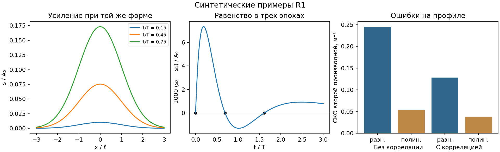

# R1. Пространственно-временная эволюция оседаний земной поверхности

**Исследовательская редакция от 26.11.2026. Объект приложения — СКРУ‑1.** Оседание считаем положительным вниз. Под эпохой понимаем момент или документированный интервал измерения. Точные утверждения ниже относятся к явно заданному классу полей или моделей. Пригодность опубликованных наблюдений рассматривается отдельно в §7. Разбор замечаний к редакции T03 v0.3-r2 вынесен во [второй документ](R1_REVIEW_AND_OPEN_QUESTIONS_RU.md).

**Основной результат.** При известных начальных значениях и согласованных опорах последовательность приращений точно восстанавливает последовательность уровней. Прогнозная ценность возникает, когда последние изменения различают будущие отклики, оставшиеся неразличимыми, например, по одному текущему максимуму. Даже положительная монотонная ползучесть при одинаковом нагружении допускает совпадение во всех наблюдавшихся эпохах и расхождение в следующей. Геометрические признаки пригодны лишь в тех направлениях и на тех масштабах, которые различает сеть. Эти выводы следуют соответственно из обратимости разностей (§3), конструкции двух спектров памяти (§6.3) и ранга измерений (§7).

## 1. Величины и область определения

Пусть $r=(x,y)$ обозначает точку фиксированной горизонтальной карты исходной поверхности, $t$ — время, $u$ — перемещение соответствующей материальной точки, $e_z$ — единичную вертикаль вверх. Определим $s(r,t)=-e_z\cdot u(r,t)$ относительно принятого исходного состояния. Разность высот рельефа в фиксированной плановой точке при горизонтальном движении может отличаться от этой величины (§4.1). За единицы $L,T$ можно взять метр и год. Все временные производные ниже берутся при фиксированном $r$, если явно не перемещается точка. Для точки на кривой используется длина дуги; для площади и объёма под графиком — горизонтальная мера $d^2r$.

| Величина | Единица | Смысл и предпосылка |
|---|---|---|
| $s,\ \Delta s,\ M$ | $L$ | Уровень, разность эпох, максимум на указанной области. Уровень и максимум зависят от нуля |
| $v=s_t,\ a=s_{tt}$ | $L/T,\ L/T^2$ | Мгновенная скорость и ускорение на гладкой ветви |
| $g=\nabla s,\ H=\nabla^2s$ | $1,\ L^{-1}$ | Уклон поля оседания и его пространственные производные второго порядка в ортонормированных координатах |
| $c,\dot c,\ell$ | $L,\ L/T,\ L$ | Центр выбранной формы, скорость его движения по карте и пространственная длина |
| $M(t), r_*(t), M_{\rm line}(t)$ | $L,\ L,\ L$ | Максимум поля, его положение и максимум на линии. При полном покрытии линии $M_{\rm line}\le M$ |

След поверхности в T01/T03 фиксирует наблюдаемый выход механики. Состояние $X$ дополнительно содержит внутренние напряжения, переменные ползучести, историю выемки и состояние контактов. Одинаковая отметка репера совместима с разными $X$. В T02 различены ядро пространственного влияния, ядро наследственности и редуцированная механическая подсистема. Ниже у каждого из первых двух свой аргумент, единица и область применимости. Архив v0.3-r2, T01 §5, T02 §§3–5, T03 §§1–4, M01 §5.

## 2. Что описывают существующие методы

### 2.1. Типовая кривая и вынимаемая мощность

На одном главном сечении полумульды выбирают начало отсчёта, ориентацию, амплитуду $A$ и длину краевой части $L_b>0$. При безразмерной координате $z=(x-x_0)/L_b$ профиль имеет вид

$$
s(x)=A S(z),\qquad s_x={A\over L_b}S'(z),\qquad s_{xx}={A\over L_b^2}S''(z). \tag{1}
$$

Первое равенство задаёт эмпирическое семейство; два других следуют по правилу цепочки при фиксированных $A,L_b,x_0$ и соответствующей гладкости $S$. Единицы последовательно $L,1,L^{-1}$. При развороте оси знак первой производной меняется. Табличные $S',S''$, установленные на определённом интервале реперов, могут быть эмпирическими характеристиками конечной базы. При работе с таблицей нужно сохранить этот интервал и её знаковую конвенцию. В пособиях Орлова (часть 1, стр. 70–71) и Михайловой и Роговой (§5.5.1, PDF 84–85, формулы 5.3–5.6) кривая нормирована длиной полумульды и наибольшим оседанием. У Орлова существенны глубина, угол падения, вынимаемая мощность и размеры выработанного пространства. Часть 2 (PDF 42) связывает размещение дополнительных линий и выбор промежуточных серий с условиями залегания и отработки. Орлов, ч. 1 · ч. 2 · Михайлова и Рогова.

**Особенность методики ВКМ.** В руководстве Соловьёва и соавторов, §8.5.1, разворот PDF/корпуса 170, печатные стр. 338–339, задана краевая часть $L_b=D(\cot\delta_0+\cot\psi)$ при глубине $D$ и соответствующих граничном угле и угле полных сдвижений. В таблице 8.26 кривые различаются по нагружению целиков и заполнению закладкой, примечание указывает базу 30 м. В строке (8.138) на изображении стоит $A/L_b^2$ для наклона. При безразмерной $S'$ это имеет размерность обратной длины. Формула (1) даёт $A/L_b$; в реестре уже отмечен конфликт FC‑042. Это независимая проверка известного расхождения. Численные значения старых углов и табличные параметры требуют установления редакции и участка. Руководство, §8.5.1 · [реестр, MM-SUBS-010 и 017](../../catalogues/mathematics/MATHEMATICAL_MODEL_REGISTRY.csv).

Для условий, изложенных Лебедевой в §2.4, предельная амплитуда от одного сильвинитового пласта при степени нагружения целиков $C$ записана как

$$
A_\infty=0.9\,m_o\,\omega\,p
\begin{cases}
(C/0.32)^2,&C<0.32,\\
1,&C\ge0.32 .
\end{cases} \tag{2}
$$

$m_o$ — вынимаемая мощность [$L$], $\omega$ — расчётный коэффициент извлечения, $p$ — параметр закладки, $C$ и остальные множители безразмерны. Обе ветви согласуются по значению в пороге. Для карналлитового пласта В с механизированным внесением закладки источник указывает отдельное условие использования второй ветви. Многопластовое суммирование предельных величин — допущение изложенной методики. Фактический максимум суммы полей достигает суммы их максимумов лишь при общем месте максимума (для непрерывных полей на компакте). Порог завершения процесса в той же главе использует одновременно скорость менее 2 мм/год и превышение 90 % конечного оседания. Это критерий методики; для закона $s(t)$ он не даёт ни даты достижения, ни момента ускорения. Проверены PDF 54–55, (2.1)–(2.2), и библиография, PDF 125, №69. Самостоятельный полный текст исходных «Указаний» 2022 г. в проверенных маршрутах не получен. Лебедева.

В диссертации Бабаянц для одиночной лавы используется $s=A S_1(\xi)S_2(\eta)$ в нормированных главных сечениях (в записи источника одна буква $S$). Размерность задаёт $A$. Это предпосылка разделимости в согласованных осях. Два измеренных сечения сами по себе не определяют произведение вне этих осей. Всякая гладкая добавка $xy\,q(x,y)$ в координатах с осями вдоль сечений оставляет оба профиля прежними. Исходный пример относится к методике длинного очистного забоя; геометрию камерной системы СКРУ‑1 он не устанавливает. Бабаянц, PDF 87–89, (4.11)–(4.16).

### 2.2. Пространственное ядро, контур и глубина

В изотропной модели Кноте для горизонтальной поверхности введём нормированное ядро и интеграл над фактически заданной в модели областью выемки $E$:

$$
K_R(r)={1\over R^2}\exp\!\left(-{\pi |r|^2\over R^2}\right),\quad
R=D\cot\beta,\quad
U(r)=\int_E K_R(r-\xi)\,q(\xi)m(\xi)\,d^2\xi . \tag{3}
$$

$R,D,m$ имеют единицы $L$, $K_R$ — $L^{-2}$, $q$ — безразмерный эффективный коэффициент, $U$ — $L$. Здесь $\beta$ — угол основного влияния в данной модели; граничный угол из §2.1 имеет своё определение. Нормировка следует интегрированием в полярных координатах. Для постоянного $qm$ и бесконечной полосы $|x'|\le b$ интегрирование сначала по $y'$, затем замена $u=\sqrt{\pi}(x'-x)/R$ дают

$$
U(0)=qm\,\operatorname{erf}(\sqrt{\pi}b/R),\qquad
\operatorname{erf}(u)={2\over\sqrt\pi}\int_0^u e^{-w^2}\,dw . \tag{4}
$$

Таким образом, при прочих равных максимум узкой полосы уменьшается с ростом глубины через $b/R$; на широкой полосе он стремится к $qm$. При одинаковом $b/R$ центральная амплитуда одинакова для разных пар глубины и ширины. Для произвольного контура различаются и наклоны вдоль его границ. В этой модели увеличение $R$ сглаживает короткие волны: при преобразовании Фурье с множителем $e^{-ik\cdot r}$ отклик гармоники умножается на $\exp[-R^2|k|^2/(4\pi)]$. Для любого конечного $k$ множитель положителен. Обратное восстановление коротких волн практически неустойчиво при шуме. Это конкретный пример к RC‑T4, со строгим различием между потерей разрешения и точным нулём. Для слоистого неоднородного массива возможен оператор $K(r,\xi)$, зависящий от обеих точек; для изменения контакта, разрушения или закладки линейная суперпозиция требует отдельного физического обоснования. [Hejmanowski, §2, (1)–(4)](https://link.springer.com/article/10.1007/s40789-015-0092-z) · [Misa, 2023, (1)](https://journals.pan.pl/Content/129740/PDF/Misa.pdf).

### 2.3. Время, вход выемки и память пород

В законе Кноте $U(t)$ означает конечный отклик, который получился бы при остановке изменения выемки в момент $t$. Предположение $\dot s=c(U-s)$, $c>0$ [$T^{-1}$], означает задержку первого порядка. Умножение на $e^{ct}$ и интегрирование дают

$$
s(t)=e^{-c(t-t_0)}s(t_0)+\int_{t_0}^t c e^{-c(t-\tau)}U(\tau)\,d\tau . \tag{5}
$$

Для ступени $U=A$ и $s(0)=0$ получаются $s=A(1-e^{-ct})$, $v=Ac e^{-ct}$, $a=-Ac^2 e^{-ct}$ при $t>0$. Один неподвижный источник с такой задержкой и $A>0$ не даёт начальной стадии нарастания скорости. При движении фронта $a=c(\dot U-v)$ может менять знак даже при постоянных параметрах пород. Интегрирующий множитель в (5) проверен подстановкой в уравнение (4) Hejmanowski; в отображённой издателем формуле (5) знак экспоненты под интегралом расходится с этим уравнением. [Hejmanowski, §2](https://link.springer.com/article/10.1007/s40789-015-0092-z).

Объединение (3) и причинного ступенчатого отклика $F(h)$ возможно при линейности, фиксированном во времени операторе и разложении выемки на независимые вклады. Если $d m_e(\xi,\tau)$ — приращение эффективной отработанной мощности [$L$] в точке по времени, одна допустимая запись при нулевой предыстории такова:

$$
s(r,t)=\int_E\int_{[t_0,t]} K(r,\xi)F(t-\tau)\,d m_e(\xi,\tau)\,d^2\xi . \tag{6}
$$

$F$ безразмерна и равна нулю при отрицательном возрасте. Атом по времени означает событие конечной мощности. Если мощность уже накоплена до $t_0$, требуется отклик предыстории. В (5) под интегралом стоит **уровень** $U$, в (6) — **приращение** мощности. Для экспоненциальной задержки связь между этими записями следует интегрированием по частям, поскольку $F'(h)=ce^{-ch}$ при $h>0$. Использование накопленной мощности вместо $d m_e$ в (6) без смены ядра нарушает размерность и повторно учитывает старую выемку.

Барях, Константинова и Асанов описывают зависимость ползучести соляных пород от нагружения, бокового давления и накопленных деформаций (PDF 63). На рис. 106 отдельно сопоставлены расчётные и экспериментальные кривые над отработанными пластами (PDF 177–179). Ермашов различает метод типовой кривой, переменные модули с заданной историей роста оседаний и реологическую модель целика с несколькими стадиями ползучести (PDF 26–28, 119–124). Его вывод об изменении крутизны края и сравнении с профилями имеет область соответствующего расчёта; в выводах присутствуют участки СКРУ‑2. Закон образца, закон деформации целика и временная функция оседания поверхности требуют разных наблюдений. Если $\eta(t)$ использована для задания модуля в MM-CREEP-012, совпадение с этой же $\eta(t)$ не служит независимой проверкой. Новый пример ВКМ у Васильевой сравнивает типовую кривую, интерполяцию и геомеханический расчёт для ненаблюдаемого края на другом руднике. Выбор способа продолжения профиля влияет на производные. Барях и соавт. · Ермашов · [Васильева, 2025, стр. 16–19](https://journal.permsc.ru/index.php/echo/article/download/3177/2525/10036).

На гладкой ветви механической модели T01 с уравнениями $R(q,z,B,\theta,t)=0$, $\dot z=F$, $s=T_s q$ получаем дифференцированием
$$
R_q\dot q=-(R_zF+R_B\dot B+R_\theta\dot\theta+R_t),\qquad
\partial_t H=\nabla^2(T_s\dot q+\dot T_s q). \tag{7}
$$
$R$ — механический остаток, $B,\theta$ — входы и параметры, $z$ — память, $T_s$ включает знак вертикальной компоненты. Для решения на $\dot q$ требуется обратимость $R_q$ на допустимом подпространстве. Единицы обеих частей первого равенства — единицы соответствующей строки остатка за время, второго — $1/(LT)$. Формула предполагает фиксированную пространственную связность, регулярный след, дифференцируемые входы и неизменный режим. В частности, наблюдаемый $H$ сам не замыкает (7). В моменты выемки, перехода контакта или изменения карты следа следует сопоставлять односторонние состояния в общей системе отсчёта.

## 3. Теория временных приращений

### 3.1. Композиция, обращение, окно

Положим $D_{ij}s(r)=s(r,t_j)-s(r,t_i)$ [$L$]. При одинаковой точке, опоре и определении $s$ имеем
$$
D_{ik}=D_{ij}+D_{jk},\qquad D_{ji}=-D_{ij},\qquad
s(r,t_n)=s(r,t_0)+\sum_{i=0}^{n-1}D_{i,i+1}s(r). \tag{8}
$$
Здесь первое равенство — равенство операторов над одним полем. Доказательство состоит в сокращении промежуточного уровня. Для окон длины $h,k$ отсюда следует $\Delta_{h+k}s(t)=\Delta_h s(t)+\Delta_k s(t+h)$. Повторное применение оператора даёт другую величину: $\Delta_h^2s(t)=s(t+2h)-2s(t+h)+s(t)$. При неполном графе пар эпох путь телескопируется. В каждой связной компоненте графа требуется один исходный уровень на точку; сумма идеальных разностей по замкнутому контуру равна нулю. Если пары построены из единого массива высот, нулевая сумма выполнена алгебраически и не проверяет точность высот. У независимо измеренных пар невязка контура информативна.

Для абсолютно непрерывной траектории при фиксированном $r$
$$
D_{ij}s=\int_{t_i}^{t_j}v(r,u)\,du,\qquad
\bar v_{ij}={D_{ij}s\over t_j-t_i}. \tag{9}
$$
$\bar v$ [$L/T$] — среднее по прямоугольному окну. При непрерывной $v$ оно достигается в некоторый, вообще неизвестный, момент внутри окна. Для гладкой $v$ среднее отличается от скорости в середине не более чем на $\|v''\|_\infty h^2/24$, $h=t_j-t_i$, по интегральному остатку Тейлора. Средняя скорость объединённых окон есть взвешенное **по длительностям** среднее. Более длинное окно сохраняет суммарное оседание, но может скрыть смену знака скорости или ускорения.

Для правонепрерывной траектории, абсолютно непрерывной между конечным числом событий, в (9) добавляется $\sum_{t_i<t_e\le t_j}[s]_e$, где $[s]_e=s(t_e+)-s(t_e-)$. В широком классе функций ограниченной вариации существует также сингулярная непрерывная часть меры $ds$; запись «интеграл скорости плюс скачки» для всего этого класса неверна. При скачке только скорости $s$ непрерывно, а атом появляется в $dv$. Конечный прирост не локализует дату события внутри окна. Ошибка репера, смена опоры и физический скачок требуют разных свидетельств.

### 3.2. Неравномерные эпохи и смысл ускорения

Обозначим $h=t_i-t_{i-1}>0,\ k=t_{i+1}-t_i>0$, $d_-=(s_i-s_{i-1})/h$, $d_+=(s_{i+1}-s_i)/k$. Через три значения проведём квадратичный полином $p(t_i+\tau)=s_i+b\tau+c\tau^2/2$. Тогда $d_-=b-ch/2$, $d_+=b+ck/2$, откуда
$$
b={k d_-+h d_+\over h+k},\qquad c={2(d_+-d_-)\over h+k}. \tag{10}
$$
$b$ [$L/T$] и $c$ [$L/T^2$] точно воспроизводят скорость и ускорение квадратичной траектории. Для $C^4$ разложение даёт $b=s'_i+hk\,s'''_i/6+O(hk\max(h,k))$, $c=s''_i+(k-h)s'''_i/3+O(h^2+k^2)$ с размерными константами, зависящими от высших производных. При $k=h$ получаем центральные формулы $(s_{i+1}-s_{i-1})/(2h)$ и $(s_{i+1}-2s_i+s_{i-1})/h^2$ второго порядка. Построенная в середине тройки оценка использует следующую эпоху и становится доступной только в $t_{i+1}$. Общий способ получения весов по точности на многочленах рассмотрен у Форнберга. [Fornberg, 1988](https://people.sc.fsu.edu/~jburkardt/m_src/differ_arbitrary/fornberg.pdf).

Есть точный смысл у $c$ и для непараболической траектории. Если $v$ абсолютно непрерывна, то $c=\int w_i(u)a(u)\,du$, причём
$$
w_i(u)={2\over h+k}
\begin{cases}
(u-t_{i-1})/h,&t_{i-1}\le u\le t_i,\\
(t_{i+1}-u)/k,&t_i<u\le t_{i+1},\\
0,&\text{вне окна}.
\end{cases} \tag{11}
$$
Подстановка $v(u)=v(t_i)+\int_{t_i}^u a(w)\,dw$ в обе средние скорости и перестановка интегралов дают (11). Шляпочная функция неотрицательна, имеет единичный интеграл, единицу $T^{-1}$ и центр масс $t_i+(k-h)/3$. Поэтому $c>0$ означает положительное **взвешенное среднее** ускорение. Сильное кратковременное замедление внутри окна совместимо с $c>0$. Для произвольного увеличения окна (10) описывает другую величину.

### 3.3. Изменение масштаба и опоры

| Изменение | Что сохраняется и при каких условиях | Что меняется |
|---|---|---|
| Переход к $s'=s+b(r)$ с неизвестным постоянным во времени полем исходных отметок | Приращения в тех же материальных точках точно совпадают | Пространственные производные уровней меняются на производные $b$. При единой константе сохраняются ещё $g,H$ и положение максимума |
| Ошибка нуля эпохи $b_i$ одинакова по площади | Внутри одной эпохи сохраняются пространственные разности, положения экстремумов и уклоны | $\widehat D_{ij}=D_{ij}+b_j-b_i$; единообразное оседание неотличимо от дрейфа. Пространственный контраст двух реперов по двум эпохам убирает оба постоянных смещения |
| Неподвижный поворот карты $r=Qr'+d$, $Q^TQ=I$ | При составах с одной картой сохраняются уровни, физические длины, спектр $H$; $g'=Q^Tg,\ H'=Q^THQ$ | Меняются компоненты и координаты центра; знак собственной оси произволен |
| Нормировка $r=r_0+\ell\xi,\ t=t_0+\tau u,\ s=A f$ | (8) сохраняет вид; $D s=A D f$ при соответственных эпохах | $g=(A/\ell)\nabla_\xi f$, $H=(A/\ell^2)\nabla_\xi^2 f$, $v=(A/\tau)f_u$, $a=(A/\tau^2)f_{uu}$. Это замена единиц или масштаба модели, а не измерительное сглаживание |
| Фиксированное линейное пространственное усреднение $P_\ell$ | $D_{ij}(P_\ell s)=P_\ell D_{ij}s$ по линейности. С производными свёртка коммутирует на всей плоскости при подходящей регулярности | Ширина, положение максимума нескольких куполов и вклад кратких волн зависят от $\ell$, границ и маски. Нелинейное выделение максимума обычно не коммутирует с усреднением |
| Смена сети или разрешения $P_i\to P_j$ | Приведение к общему измеряемому носителю позволяет сравнить одинаковые функционалы | $P_j s_j-P_i s_i=P_jD_{ij}s+(P_j-P_i)s_i$ в общем пространстве выходов. Второй член имитирует эволюцию даже у неподвижного поля |
| Подвижная карта $r=\phi_t(\xi)$ | Разность вдоль траектории точки остаётся разностью двух значений | $\partial_t(s\circ\phi_t)=v\circ\phi_t+(\nabla s\circ\phi_t)\cdot\dot\phi_t$. Вращение, миграция репера или ошибочная привязка могут дать ложную скорость |

Если датированы только годы, интервалы между номерами годов — номинальные окна. При известных границах $h\in[h_-,h_+]$, $h_->0$, положительном $D$ и пренебрежимо малой ошибке $D$ скорость заключена между $D/h_+$ и $D/h_-$. При неопределённом знаке нужна полная интервальная арифметика. Неизвестный момент внутри года нельзя устранить дополнительными десятичными знаками.

## 4. Геометрия уровня, вершины и формы

### 4.1. Уклон и кривизна

В точке и единичном направлении $d$ разложение поля есть $s(r+\rho d)=s(r)+\rho\,g\cdot d+\rho^2 d^THd/2+o(\rho^2)$. Направление максимального роста первого порядка — $g/|g|$ при $g\ne0$. Направления экстремальных вторых производных — ортогональные собственные оси симметричного $H$ по принципу Рэлея. При совпадении собственных значений ось не определена. При почти равных значениях малая ошибка матрицы может повернуть оси на большой угол. Уклон и главная ось второго порядка вообще различны. При пространственно-временной гладкости на фиксированной плоскости $\partial_tg=\nabla v,\ \partial_tH=\nabla^2v$ по перестановке производных; это кинематика.

Для поверхности, которая **в текущих горизонтальных координатах** является графиком высоты $z(r)$, параметризация $X=(x,y,z)$ даёт первую и вторую фундаментальные формы и нормальную кривизну относительно нормали вверх:
$$
G=I+\nabla z\,\nabla z^T,\qquad B={\nabla^2 z\over\sqrt{1+|\nabla z|^2}},\qquad
\kappa(d)={d^TBd\over d^TGd}. \tag{12}
$$
Они следуют из $G_{ij}=X_i\cdot X_j$, $B_{ij}=n\cdot X_{ij}$. Главные кривизны [$L^{-1}$] — собственные числа задачи $B d=\kappa G d$. Только для исходного горизонтального рельефа и отсутствующего горизонтального смещения (либо его корректного учёта при переходе к графику) можно подставить $z=z_0-s$ с постоянной $z_0$. При малых уклонах получаем $-\nabla^2s$ в первом приближении, а в точке нулевого уклона равенство матриц кривизны для этого графика точно. Для переменного исходного рельефа и горизонтального смещения $u_h$ нужна параметризация $(r+u_h,z_0(r)-s)$ и её производные. Смена ориентации нормали обращает знаки кривизн. Нормальное смещение в первом порядке равно проекции $u\cdot n_0$ на исходную единичную нормаль. Она совпадает с вертикалью только на горизонтальной площадке. [Shifrin, гл. 2, §§1–2](https://www.math.uga.edu/sites/default/files/inline-files/ShifrinDiffGeo.pdf).

### 4.2. Максимум, миграция, ширина

Пусть область компактна, у максимизатора $r_*$ есть зазор относительно конкурирующих ветвей вне его окрестности, максимум внутренний и $H(r_*,t)$ отрицательно определён. Для гладкого поля с непрерывными необходимыми смешанными производными теорема о неявной функции даёт локальную гладкую ветвь. Дифференцируя $\nabla s(r_*,t)=0$ и $M=s(r_*,t)$, получаем
$$
\dot r_*=-H^{-1}\nabla v,\qquad \dot M=v(r_*,t),\qquad
\ddot M=a(r_*,t)-(\nabla v)^TH^{-1}\nabla v . \tag{13}
$$
Единицы $L/T,L/T,L/T^2$ соответственно. Последнее слагаемое с учётом минуса неотрицательно. Поэтому ускорение неподвижного репера, мгновенно совпавшего с вершиной, может быть отрицательным при постоянном $M$. На плато, у границы и при обмене лидирующих пиков (13) в таком виде неприменимо. При непрерывных $s,v$ на фиксированном компакте правая производная $M$ равна максимуму $v$ на активном множестве, левая — минимуму (при существовании двухсторонней временной окрестности). Это следует, сравнивая значения в прежних и новых максимизаторах и переходя к сходящейся подпоследовательности. Уникальный максимум на границе требует учёта ограничений. [Bernhard и Rapaport, формулировка теоремы Данскина](https://www-sop.inria.fr/members/Pierre.Bernhard/publications/berrap95.pdf).

Всегда $|\max s-\max\hat s|\le\|s-\hat s\|_\infty$. Для положения вершины нужна дополнительная информация. Если $s(r_*)-s(r)\ge\mu|r-r_*|^2/2$ в окрестности и все внешние точки уступают вершине более чем на $2\varepsilon$, то при $\|s-\hat s\|_\infty\le\varepsilon$ любой максимум $\hat r$ удовлетворяет $|\hat r-r_*|\le2\sqrt{\varepsilon/\mu}$. Доказательство: $s(r_*)-s(\hat r)\le2\varepsilon$. Единица $\mu$ — $L^{-1}$. Для почти плоского дна бессмысленно сообщать единственную точку без ошибки локализации.

Для семейства $s=b+A\exp[-(r-c)^T\Sigma^{-1}(r-c)/2]$, $A>0$, $\Sigma$ симметрична и положительно определена с единицами $L^2$. Вершина в $c$, высота над фоном $A$, $H(c)=-A\Sigma^{-1}$. Полуширины контура половины высоты вдоль собственных осей равны $\sqrt{2\ln2}\sqrt{\lambda_j(\Sigma)}$; полная ширина вдвое больше. Это следует из уравнения уровня. Одна крутизна вершины связывает $A$ и ширину через их отношение, а движение $c$ её собственных чисел не меняет. Отождествлять полуширину по уровню с длиной краевой части типовой кривой можно только по дополнительному преобразованию. У произвольной мульды одинаковые $A,g,H$ в вершине совместимы с разными хвостами: добавка, тождественно нулевая в окрестности вершины, меняет удалённый контур.

### 4.3. Увеличение амплитуды, перенос и изменение профиля

Пусть $s(r,t)=b(t)+A(t)f(\xi,t)$, $\xi=B(t)^{-1}(r-c(t))$, $B$ — обратимая матрица масштаба и ориентации [$L$], $f$ безразмерна. Дифференцируя $r=c+B\xi$ при фиксированном $r$, получаем точное равенство
$$
s_t=\dot b+\dot A f-[\dot c+\dot B B^{-1}(r-c)]\cdot\nabla s
       +A\,(\partial_t f)_\xi . \tag{14}
$$
В правой части последовательно видны смещение общего нуля, усиление, движение вместе с изменением масштаба и остаточная эволюция в подвижных координатах. Все члены имеют единицу $L/T$. Само равенство допускает бесконечно много таких разложений. Нужны фиксированные правила выбора фона, центра и ширины (например, максимум и полуоси контура на относительном уровне при единственном пике) и указание, входит ли расширение в «собственное изменение формы». При круговой симметрии профиль допускает любое вращение без изменения поля. На части склона перенос почти пропорционален усилению, если $f_x\approx kf$.

Для выбранного поля $w$ (уровень над фоном, скорость или средняя скорость окна) и фиксированного скалярного произведения $Q$ нормируем $f_w=w/\|w\|_Q$. При $w\ne0$ дифференцирование нормы даёт $\partial_t f_w=(I-f_w\otimes_Q f_w)w_t/\|w\|_Q$. Норма этого выражения [$T^{-1}$] устраняет только усиление. Перенос меняет $f_w$ в неподвижной системе. Чтобы выделить остаток, проектируем $w_t$ на линейную оболочку полей $w,-w_x,-w_y$ и, если заявлено, генератора поворота или дилатации. Для базисных полей $p_j$ необходимые условия минимума $\|\dot w-\sum_j a_jp_j\|_Q^2$ суть $\sum_j\langle p_i,p_j\rangle_Q a_j=\langle p_i,\dot w\rangle_Q$. Коэффициенты однозначны ровно при полном ранге матрицы Грама после применения наблюдаемой маски и опоры. Для точной проекции достаточно однозначного образа, даже если отдельные коэффициенты неопределимы. При штрафе за скорость движения остаток зависит от штрафа. Ортогональность тогда вообще утрачивается. В норме T03, включающей гессианы с весом $\ell^4$, для $\nabla w$ обычно требуется ещё одна пространственная производная. При малой норме сигнала направление нестабильно. Разложение уровня $s$ и разложение $v$ в T03 §5.1 отвечают на разные вопросы: перемещающееся колоколообразное углубление имеет двузнаковое поле скорости.

Глобальные ширины можно определять и без предположения о гауссовой форме. При фиксированном фоне, $w=(s-b)_+$, конечных вторых моментах и $V=\int w\,d^2r>0$ зададим $\bar r=V^{-1}\int rw\,d^2r$ и $\Sigma_w=V^{-1}\int(r-\bar r)(r-\bar r)^Tw\,d^2r$. При чистом усилении $w$ оба момента сохраняются, при жёстком переносе на всей площади $\bar r$ переносится на то же расстояние и $\Sigma_w$ сохраняется; доказательство — замена переменной в интеграле. Квадратные корни из собственных значений $\Sigma_w$ задают масштабы [$L$]. Вторая мульда, обрезанная маска или меняющийся фон меняют такие ширины даже при неизменном первом пике. Они характеризуют весь выбранный носитель.

## 5. Когда приращение имеет прогнозное значение

Обозначим через $Y=(y_0,\ldots,y_n)$ полную доступную историю наблюдений и через $J$ — заранее заданный будущий выход при оговорённых будущих воздействиях. На одном носителе преобразование $Y\mapsto(y_0,d_1,\ldots,d_n)$, $d_i=y_i-y_{i-1}$, взаимно однозначно по (8). Любое правило, использующее приращения, можно записать как функцию $Y$. При фиксированном совместном распределении условный закон $J$ при полной истории не меняется от добавления вычисленных по ней признаков. В вероятностной записи $I(J;D\mid Y)=0$ для $D=f(Y)$, когда условная информация определена. Удаление $y_0$ теряет общий уровень. Это уместно для цели, инвариантной к такому сдвигу, или при обоснованно неизвестной опоре. Независимый прибор, непосредственно измеряющий разность, может дать другой шум и другую информацию.

**Критерий для сравнения с ограниченным набором признаков.** Пусть $S(Y)$ — известный показатель, например последний максимум, $D(Y)$ — приращение, а сравнение ведётся в классе допустимых историй и будущих входов $\mathcal C$. Обозначим множество целевых значений при $S=s_0$ через $\mathcal J(s_0)$, а при дополнительном $D=d$ через $\mathcal J(s_0,d)$. Во втором случае набор совместимых историй вложен в первый; диаметр будущих значений не возрастает. Для утверждения о строгом улучшении нужно показать строгое уменьшение диаметра в рассматриваемых группах либо улучшение заранее определённого критерия риска. Для скалярной цели минимаксная ошибка на ограниченном непустом множестве с концами $a,b$ равна $(b-a)/2$: треугольное неравенство даёт нижнюю границу, середина её достигает. Редукция шума посредством выбора конкретной статистической модели — ещё одно возможное практическое преимущество, но она не следует из обратимости (8).

Например, в узком семействе $s(t)=s_n+v(t-t_n)$ с постоянной неизвестной $v$ и неизменным будущим входом по одному $s_n$ при неизвестной истории $v$ не определяется. Одна предыдущая эпоха восстанавливает $v=d/h$, а тем самым условный будущий выход. Это аналитическая иллюстрация роли модели и горизонта, без прогноза по руднику. При разрешённом изменении $v$ сразу после последней эпохи вывод теряется. При неизвестных воздействиях даже точно известное начальное состояние не определяет уникального будущего.

В конечномерной линеаризации на допустимом касательном пространстве пусть $A$ переводит возмущения в доступную историю после исключения свободного нуля, $B$ — в будущую цель. В точных данных цель однозначна по истории в первом порядке тогда и только тогда, когда $\ker A\subseteq\ker B$. Необходимость следует из двух состояний с разностью в ядре $A$. При включении ядер правило $C(Ad)=Bd$ корректно на образе $A$, т.е. $B=CA$. Устойчивость зависит от нормы $C$ в физических шкалах. При шуме следует ограничить допустимые $d$ и оценить $\sup\{\|Bd\|:\|Ad\|\le\delta,\ \|d\|\le1\}$ после обезразмеривания. Критерий локален. В §6.3 нет линеаризации: там построена пара с точно одинаковой наблюдаемой историей. Поэтому G3 остаётся проверяемой гипотезой об относительной полезности формы для конкретной цели и сети.

## 6. Контрпримеры и физический смысл

### 6.1. Ускорение без изменения формы

Положим $s=A_0 F(t/T)f(r)$, где $f=\exp(-|r|^2/(2\ell^2))$, $A_0,\ell,T>0$, $F(u)=1-(1+u)e^{-u}$ при $u\ge0$. Тогда $F'=ue^{-u}$, $F''=(1-u)e^{-u}$. На $0<t<T$ оседание нарастает с положительным ускорением, $M''=A_0F''/T^2>0$. Для любых двух возрастающих эпох внутри этого интервала поле приращений — положительный множитель $f$. Его нормированная форма неизменна; то же верно для $v$ при $t>0$. При $t=0$ нормировка $v$ не определена. Функция $F$ есть ступенчатый отклик каскада двух устойчивых звеньев $T\dot x_1+x_1=1$, $T\dot x_2+x_2=x_1$, $x_1(0)=x_2(0)=0$. Это возможная задержка в редуцированном классе. Механический закон конкретного пласта из этой конструкции не следует. Опровергнута необходимость изменения формы для ускорения, сохранён условный вопрос G3.

### 6.2. Перенос, смена пика, граница

Пусть $s=A\exp[-(x-ct)^2/(2\ell^2)]$ при постоянных $A,\ell>0$. В вершине $H=-A/\ell^2$, $v_x=Ac/\ell^2$, $a=-Ac^2/\ell^2$. Тогда (13) даёт $\dot x_*=c$, $\dot M=\ddot M=0$. В фиксированном репере видна меняющая знак скорость. При интерпретации как накопленного необратимого оседания всех материальных точек чистый перенос требует местного поднятия на уходящем склоне; допустимость такого режима должна следовать из механики. Как кинематический тест он точен.

Для двух разделённых неперекрывающихся гладких неотрицательных функций с максимумом 1 на расстоянии $2d$ возьмём амплитуды $A(1+u), A(1-u)$, $|u|<1$, $u=t/T$. Получаем $M=A(1+|u|)$; в нуле имеются две вершины, правая и левая скорости равны $+A/T$ и $-A/T$. Это изменение ведущей ветви без перемещения центров. Для слияния удобна локальная нормальная форма $s/A=1-(X^2-u)^2$, $X=x/\ell$. Вблизи $u=0$ при $u>0$ имеются две вершины $X=\pm\sqrt u$, при $u=0$ вершина четвертого порядка; при $u<0$ один пик в нуле. На ограниченной площадке можно добавить фон. Обращение $H$ в момент слияния невозможно. На полуоси $X\ge0$ для $s/A=1-(X-u)^2$ максимум находится в $\max(0,u)$ и при $u<0$ имеет ненулевой нормальный градиент. Эти примеры определяют область гладких формул; сами по себе они не описывают разрушение массива.

### 6.3. Равенство эпох и скрытая память

**Сначала факт о данных.** Для любых конечных эпох $t_i\le t_n$ можно прибавить к $s_1$ поле $a_0 f(r)\prod_i((t-t_i)/T)$ на ограниченном интервале. Измерения даже всего поля и все разности в заданных эпохах совпадут, а продолжения обычно различны. Ещё сильнее, гладкая функция, равная нулю до $t_n$ и равная $\exp[-T^2/(t-t_n)^2]$ после него, скрывает отличие на всём прошлом. Это конструкция в классе гладких функций; произвольная добавка не обязана решать уравнения механики.

**Совпадение конечных эпох в пассивном реологическом семействе.** Пусть последовательно соединённые элементы Кельвина–Фойгта имеют пружины $E_j>0$ и вязкости $\eta_j>0$; в каждом решается $\eta_j\dot e_j+E_je_j=\sigma_0$, $e_j(0)=0$, $\sigma_0>0$ — общая ступень напряжения. При высоте образца $l$, $s=l\sum e_j$, положительном сжатии и $T_j=\eta_j/E_j=T/j$, отклик
$$
s(t)=A_0\sum_{j=1}^{m} w_j(1-z^j),\qquad z=e^{-t/T},\qquad
w_j={l\sigma_0\over A_0 E_j}>0. \tag{15}
$$
$\sigma_0,E_j$ — давления, $\eta_j$ — давление × время, $s,A_0,l$ — длины, $e_j,w_j,z$ — безразмерны. Для каждого элемента $\sigma_0\dot e_j=(E_je_j^2/2)^{\cdot}+\eta_j\dot e_j^2$: запасённая энергия и диссипация на единицу объёма неотрицательны. Обе модели стартуют из покоя и испытывают одинаковое постоянное напряжение. Мера здесь детерминирована.

Возьмём четыре моды, веса первого варианта $(1,1,1,1)$, второго $(39/40,6/5,23/40,5/4)$. Вычитание сумм даёт
$$
(s_2-s_1)/A_0=z(1-z)(z-1/2)(z-1/5)/4 . \tag{16}
$$
В эпохи $t/T=0,\ln2,\ln5$ и в пределе $t\to\infty$ отклики одинаковы. При $t/T=\ln10$ разность равна $9A_0/10000$. Оба отклика ограничены и монотонны. Для произвольного конечного числа различных положительных эпох берут многочлен $z(1-z)\prod_i(z-z_i)$: его коэффициенты представимы разностью сумм в (15), поскольку многочлен равен нулю в 1, и малое возмущение положительных весов сохраняет их положительность. Для всех указанных эпох это точная неединственность при неизвестном спектре. Её величина на нужном горизонте относительно измерительной ошибки — отдельный вопрос. Одномерное укорочение можно интерпретировать как смещение верхней границы нагруженного столба с неподвижным основанием. Перенос этой схемы на поверхность СКРУ‑1 потребовал бы закона пространственной передачи.

**Скрытое состояние при одинаковых параметрах.** В модели (15) достаточно двух элементов с различными $T_1,T_2$. Пусть к $t_0$ суммы деформаций одинаковы, а разности компонент между двумя состояниями $(+\delta,-\delta)$. При одинаковом будущем напряжении разность выходов в момент $t_0+h$ равна $l\delta(e^{-h/T_1}-e^{-h/T_2})$. Такие состояния достижимы даже при неотрицательной нагрузке. Два коротких прямоугольных импульса в разные прошлые интервалы дают столбцы отклика с компонентами $E_j^{-1}(1-e^{-d/T_j})e^{-a/T_j}$, где $d$ — ширина импульса, $a$ — его возраст. Отношения компонент различаются для разных $a$ при $T_1\ne T_2$; амплитуду каждого импульса можно положительно нормировать до одной и той же суммарной деформации. При последующей разгрузке $\sigma=0$ обе энергии убывают. Этот пример устанавливает различие памяти при одном материале и неизвестном прошлом. В (16) совпали нагрузки во всём прошлом и несколько уровней, но отличались материальные параметры. Эти два утверждения имеют разную силу. G1 имеет конструктивное основание для указанного класса; наличие такого расхождения на реальном руднике не установлено.

### 6.4. Слабая ошибка уровня и сильная ошибка производных

Пусть к истинному полю добавлено $\varepsilon\sin(kx)$, $[\varepsilon]=L$, $[k]=L^{-1}$. Ошибка значения не более $\varepsilon$, градиента — $\varepsilon |k|$, второй производной — $\varepsilon k^2$. При $k=n/\ell,\ \varepsilon=\ell n^{-3/2}$ уровень и градиент сходятся равномерно к истинным, а ошибка гессиана растёт как $\sqrt n/\ell$. При $\varepsilon=\ell n^{-1/2}$ расходится и ошибка градиента. Для оценки порядка величин возьмём следующий пример. добавка амплитуды 1 мм с длиной волны 10 м даёт $3.948\cdot10^{-4}$ м⁻¹, тогда как у гауссовой мульды амплитуды 1 м и ширины $\ell=100$ м модуль центральной второй производной $10^{-4}$ м⁻¹. Это тест измерительного возмущения. При длине волны меньше удвоенного шага равномерной сети возникает неоднозначность дискретизации; пространственное сглаживание меняет сам оцениваемый объект.

## 7. Наблюдаемость и ошибки измерения

### 7.1. Что даёт геометрия сети

Нивелирование связывает отметки реперов через измеренные превышения. Повторные циклы со стабильным исходным репером дают изменения относительных вертикальных высот. В связной сети свободен общий нуль до задания опоры. GNSS (глобальная навигационная спутниковая система) даёт компоненты смещения в заданной системе и её ошибку. Сближение кровли и почвы в подземной камере — относительное перемещение двух подземных точек. Общий вид — $y_i=\mathcal H_i[X(t_i)]+Z_i b_i+e_i$ с явной поддержкой и ковариацией. Дополнительные физические переходы между этими типами измерений требуют модели. Методика обработки повторных высот и профильных интервалов описана ВНИМИ, 1988, §§5.3–5.4 (SRC-148). Применять к $g,H$ единицы длины горизонтального интервала; номер репера не является расстоянием.

| Поддержка измерений | Идентифицируемая характеристика | Необходимое условие или точная неоднозначность |
|---|---|---|
| Гладкая линия $\gamma(l)$ с известной геометрией, параметр $l$ — длина дуги | $(s\circ\gamma)'=g\cdot d$ и $(s\circ\gamma)''=d^THd+g\cdot\gamma''$, $d=\gamma'$ | Для прямой $\gamma''=0$. На кривой у второго измерения есть вклад нормального уклона. Для прямой $y=0$ добавка $ay+bxy+cy^2$ сохраняет всю линию, меняет $g_y,H_{xy},H_{yy}$ |
| Пересечение линий в одну эпоху | Два независимых касательных направления дают двумерный градиент. Вторые направленные производные дают по уравнению на симметричный $H$ | Строки $(d_x^2,2d_xd_y,d_y^2)$ должны иметь ранг 3 после учёта кривизны трасс. У двух ортогональных линий остаётся неизвестным $H_{xy}$; направление под 45° снимает неоднозначность. Почти параллельные линии плохо обусловлены |
| Двумерная сеть | Коэффициенты локального квадратичного приближения и неопределённость в выбранном окне | Строка $[1,X,Y,X^2/2,XY,Y^2/2]$ умножается на $(s,g_x,g_y,H_{xx},H_{xy},H_{yy})$ для физических смещений $X,Y$. Нужны ранг 6, приемлемые сингулярные значения в масштабированных координатах, достаточное покрытие вокруг цели и контроль остатка Тейлора. Шесть произвольных точек могут лежать на одной конике |
| Радиолокационная интерферометрия (InSAR), одна пара эпох и орбита | Проекция смещения на линию визирования (LOS) относительно опоры и опорного пикселя | Без ограничений на горизонтальные компоненты вертикаль не идентифицируется. Две орбиты дают до двух независимых комбинаций трёх компонент. Движение с существенной северной составляющей может сместить видимые ось и максимум |
| Редкие точки по площади | Максимум среди реперов как нижняя граница истинного максимума точных уровней на этой площади | При покрывающем радиусе $h_f$, известной константе Липшица $G$ и ошибке $\le\varepsilon$ истинный максимум лежит между $\max y-\varepsilon$ и $\max y+\varepsilon+Gh_f$. Вывод — сравнение точки максимума с ближайшим репером. Без $G$ и покрытия верхней границы отсюда нет |

Пусть единичный LOS-вектор $n$ направлен от цели к спутнику и положительно смещение к нему. Тогда деформационная составляющая разности равна $n_x\Delta u_x+n_y\Delta u_y-n_z\Delta s$. При известном $\Delta u_h=0$ и $n_z\ne0$ получаем $\Delta s=-y_{\rm LOS}/n_z$ после удаления опорных и инструментальных членов. У пренебрежения горизонтальным сдвигом ошибка в единицах длины равна по модулю $|n_h\cdot\Delta u_h/n_z|$. В фазах множитель двойного пути по модулю равен $4\pi/\lambda$; знак зависит от порядка снимков. Нужны когерентность, согласование эпох и пикселей, развёртка фазы, модель атмосферы и рельефа. При разной геометрии каждой даты нужен свой оператор. Результаты Бабаянц и соавт. о близости максимумов по двум орбитам получены для их теоретической мульды, при определённой ориентации и составе компонент. [Бабаянц и соавт., 2023](https://doi.org/10.21455/gr2023.4-2) · [ESA, TM‑19, часть A, гл. 2](https://www.esa.int/esapub/tm/tm19/TM-19_ptA.pdf).

### 7.2. Полная ковариация, реконструкция и разрешение

Для вектора уровней с ковариацией $R$ матрица разностей $D$ имеет по $-1,+1$ в концах каждого интервала. Из линейности ожидания ковариация равна
$$
R_D=D R D^T,\qquad R_{\bar v}=W D R D^T W^T,\qquad W_{ii}=1/h_i. \tag{17}
$$
Для независимых равнодисперсных эпох соседние разности имеют ковариацию $-\sigma^2$, дисперсию $2\sigma^2$ и корреляцию $-1/2$. Общая постоянная ошибка нуля $\sigma_b^2{\bf1}{\bf1}^T$ сокращается; общий репер с меняющейся ошибкой создаёт ковариацию между всеми точками одного цикла. Дисперсия разности двух коррелированных уровней равна $\sigma_i^2+\sigma_j^2-2R_{ij}$; направление изменения точности зависит от $R$. Механическое объединение уровней и всех их производных даёт вырожденную совместную ковариацию. Смена регистрации точки на $\delta r$ даёт ошибку уровня первого порядка $g\cdot\delta r$. Систематическую ошибку представления лучше оценивать отдельной границей, если её совместный вероятностный закон с инструментальной ошибкой неизвестен.

При независимом шуме отсчёта $\sigma$ и равномерном горизонтальном шаге $d$, центральные первая и вторая разности имеют стандартные ошибки $\sigma/(\sqrt2 d)$ и $\sqrt6\,\sigma/d^2$: квадраты весов суммируются. При ограниченных третьих и четвёртых производных ошибки аппроксимации соответственно порядка $d^2\|s'''\|$ и $d^2\|s^{(4)}\|$. Для коррелированного шума надо применить $w^TRw$ с реальными весами. Если пространственные ошибки имеют одинаковую дисперсию и корреляции $\rho_1,\rho_2$ на расстояниях $d,2d$, дисперсия второй разности становится $\sigma^2(6-8\rho_1+2\rho_2)/d^4$. Меньший шаг уменьшает систематическую ошибку гладкости, но при независимом шуме увеличивает дисперсию.

| Способ | Что именно получаем | Ограничение |
|---|---|---|
| Локальный полином | Производные из коэффициентов на масштабе окна. На квадратичном поле оценки точны без шума при полном ранге | Большое окно даёт смещение на неоднородном склоне; малое усиливает шум и краевые эффекты |
| Сглаживающий сплайн или штраф по $H^2$ | Компромисс невязки и интеграла квадрата гессиана | Свободный аффинный тренд и общий нуль требуют опоры. Выбор границ, штрафа и масштаба влияет на результат |
| Геостатистическая оценка | Линейная оценка с ковариацией процесса и наблюдений | Неизвестные вариограмма и тренд влияют на результат; среднеквадратичные производные существуют лишь при достаточной гладкости ковариации |
| Слабая производная | Среднее по тестовой функции $\phi$: $\int H_{ij}\phi=\int s\,\partial_{ij}\phi$ для гладкой $\phi$ с компактным носителем | На границе появляются граничные члены. У кусочно-линейного поля классический гессиан равен нулю внутри элементов, скачки градиента живут на рёбрах |

В плоской ограниченной связной липшицевой области положим $K(s)=\int|\nabla^2s|_F^2 d^2r$. На $H^2$ ядро $K$ состоит из аффинных функций. Для T03 §2.2 минимизируется сумма квадрата взвешенной невязки и $\lambda K(s)$, $\lambda>0$. На пространстве с зафиксированной опорой требуется $\ker(PW\mathcal H)\cap\ker K=\{0\}$, где $W$ нормирует шум, а $P$ устраняет только действительно свободные систематические члены. В конечномерном базисе это необходимое и достаточное условие положительной определённости нормальной матрицы. В бесконечномерной постановке требуется также коэрцитивность на выбранном факторпространстве и непрерывность наблюдений. В ограниченной плоской области с обычными условиями регулярности контроль аффинной части и оценка Пуанкаре обеспечивают такой контроль нормы. При безразмерной взвешенной невязке, $s$ и $r$ в метрах, $K$ в двух измерениях безразмерен. Замена $d^2r$ на нормированную меру меняет размерность $\lambda$. Первая вариация для пробной $h$ содержит $\langle PW\mathcal H h,PW(\mathcal Hs-y)\rangle+\lambda\int\nabla^2s:\nabla^2h=0$. Два интегрирования по частям дают внутренний $\Delta^2s$ и граничные члены. Точечный гессиан не определён одним лишь условием $s\in H^2$ в 2D. Слабое решение, гладкое представление и полевой отсчёт — три разных уровня утверждения. [Wahba, Spline Models for Observational Data, гл. 1](https://epubs.siam.org/doi/book/10.1137/1.9781611970128) · [Backus и Gilbert, 1968](https://doi.org/10.1111/j.1365-246X.1968.tb00216.x).

Chilès и Delfiner (SRC‑222, PDF 46 и 83) различают среднеквадратичную дифференцируемость случайного поля и дифференцируемость его реализаций. Tarantola (SRC‑224, §3.3.2) формулирует понятие оператора разрешения. Оба различия существенны, если производную сообщают вместе с оценкой её неопределённости.

Для RC‑T5 историческая линейная чувствительность $\mathcal A$ включает перенос возмущений между эпохами. После масштабирования параметров $L$ и нормировки шума $W$ эффективная матрица $A=(I-WZ(WZ)^+)W\mathcal A L$. При вырожденной ковариации отдельно сохраняют точные ограничения и работают на стохастическом подпространстве. В безразмерном примере $A=\mathrm{diag}(1,10^{-4})$, будущая цель $B=(0,1)$; единичное возмущение второй координаты почти незаметно в истории, но меняет цель на 1. При историческом допуске $10^{-3}$ оно допустимо. При снятии единичного ограничения и точном ядре, на котором $B\ne0$, разброс в неограниченной линейной модели бесконечен. Даже полный локальный ранг не гарантирует глобальность: при измерении $\theta^2$ параметры $+\theta$ и $-\theta$ неразличимы, а выход $\theta$ различен. Наоборот, неопределённость параметра совместима с определённостью цели, постоянной на соответствующем семействе.

### 7.3. Какие утверждения допускают материалы СКРУ‑1

ПЛ‑V даёт три опубликованных сглаженных профиля. Изменение уровня и ширины на самой линии доступно как свойство авторской кривой в её системе координат. Дискретизация этой кривой с частым шагом не добавляет полевых измерений. ПЛ‑12 даёт пять годовых профилей с идентификаторами реперов и пропусками. На совпадающем носителе возможны сравнения приращений и диапазона положения профильного максимума с учётом точности чтения. Номинальные интервалы составляют 3, 9, 3 и 3 года: одинаковая разность в двух таких окнах означает различные средние скорости. Короткий всплеск внутри девятилетнего интервала может быть полностью пропущен. Существование согласованных пересечений этих профилей в общую эпоху и одной системе опор не установлено.

Реперы блока 199 дают локальную временную историю; опубликованная автором средняя скорость зависит от исходных высот и обработки. Для 5 ВП есть ряды двух реперов в относительном времени с неопределённым календарным началом. Спутниковая карта с явной подписью СКРУ‑1 и график во врезке, допускающий два рудника, имеют разную пространственную атрибуцию. Сравнить направления измерения, маски и интервалы можно; приписать врезку выбранному реперу или заполнить нулями пропущенные компоненты нельзя. Отдельные серии конвергенции относятся к камерам. Траектории L080/BH128 — расчётные отклики условных миров. История локальных событий C4 до 2025 года неполна; распределение шахтного агрегата по блокам из имеющихся рядов не определяется.

В закрытой матрице R1 для каждого набора указаны локатор, исходная величина, даты наблюдения и доступности, опора, ошибки и допустимая проверка. Ориентиры в PUBLIC — [индекс СКРУ‑1](../../evidence/world/skru1_mine/skru1_observation_index.csv), [каталог наблюдений](../../evidence/world/observations/world_observation_catalog.csv) и [сопоставление методов Мусихина](../../evidence/monitoring/musikhin_modality_comparison.csv). **Достижимый натурный вывод для ВКР** — сопоставимость отдельных профильных изменений при фиксированных реперах, окнах и знаке. Полный площадной гессиан, мгновенное ускорение всего поля и опережение будущего события по G3 по проверенному набору не идентифицированы.

## 8. Интегральные признаки и устойчивость формы

**Сглаженный максимум.** Для непрерывного $s$ на компакте, фиксированной вероятностной меры $\mu$ с полной поддержкой и $\beta>0$ [$L^{-1}$] положим $M_\beta=\beta^{-1}\log\int e^{\beta s}d\mu$. Из $s\le M$ получаем $M_\beta\le M$. Для любого $\epsilon>0$ множество $U=\{s>M-\epsilon\}$ имеет положительную меру и $M_\beta\ge M-\epsilon+\log\mu(U)/\beta$. Значит, $M_\beta\to M$ снизу. Монотонность следует из монотонности норм $L^p$ для вероятностной меры, применённой к $e^{s/L_0}$ с произвольной фиксированной длиной $L_0>0$. При дискретных положительных весах $p_i$ с суммой 1 максимум на узлах превосходит $M_\beta$ не более чем на $-\log(p_*)/\beta$ для узла максимума. До непрерывного максимума добавляется, например, $Gh_f$ из §7.1. Задавая $dw=e^{\beta s}d\mu/\int e^{\beta s}d\mu$, двукратное дифференцирование при доминировании подынтегральных производных даёт $\dot M_\beta=E_wv$, $\ddot M_\beta=E_wa+\beta\operatorname{Var}_w v$. При движущейся маске, весах или $\beta$ возникают дополнительные члены. Сумма без нормировки может превысить истинный максимум.

**Форма конечных окон.** В T03 скалярное произведение $Q$ интегрирует $fg+\ell^2\nabla f\cdot\nabla g+\ell^4\nabla^2 f:\nabla^2g$ по нормированной площади. Тогда $\|w\|_Q$ имеет единицу $w$, и $I_{\rm shape}=\|\partial_t(w/\|w\|_Q)\|_Q$ имеет единицу $T^{-1}$. $J_{\rm shape}=\int I_{\rm shape}\,dt$ — безразмерная длина пути направления; при скачке требуется отдельное расстояние между односторонними ненулевыми состояниями. Любой положительный, даже меняющийся во времени множитель в $w$ сокращается. Для конечных окон берём $w_i=D_{i,i+1}s/h_i$ на общем носителе и $f_i=w_i/\|w_i\|_Q$. Расстояние-хорда $\|f_{i+1}-f_i\|_Q$ и угол $\arccos\langle f_{i+1},f_i\rangle_Q$ безразмерны. При одинаковой шкале $Q$ отношение хорды ко времени между серединами окон даёт среднюю дискретную характеристику. При неравных $h_i$ каждый $w_i$ имеет собственное усреднение; разность хорд не выделяет изменение мгновенной формы без предпосылки о вариации скорости внутри окон. Если $\|\delta w\|_Q\le e<\|w\|_Q$, неравенство треугольника даёт $\|\widehat f-f\|_Q\le2e/\|w\|_Q$. При уровне сигнала, сравнимом с ошибкой, результат помечается как неразрешимый. В $L^2$ устойчивее уровни; добавка градиентов и гессианов усиливает малые пространственные масштабы и требует разрешения более высоких производных. Длину $\ell$ ограничивают поддержкой сети и предметным масштабом, заранее для сравниваемых окон.

Совмещение профилей по максимуму просто при устойчивой единственной вершине, но не определяет движение плато. Корреляция центрированных профилей может обнаруживать сдвиг на общем отрезке, однако повторяющийся рисунок допускает несколько оптимальных сдвигов. Моменты §4.3 устойчивее локального гессиана к коротковолновому шуму, но чувствительны к неполному охвату хвостов. Параметрическая модель различает только включённые в неё формы. Градиентная регистрация и её нормальные уравнения имеют известный аналог у Лукаса и Канаде (§2); вклад R1 состоит в явном учёте окон, опоры и наблюдаемых направлений для маркшейдерской задачи. [Lucas и Kanade, 1981](https://courses.cs.duke.edu/cps274/fall11/papers/LucasKanade81.pdf).

**Уровни, площадь, объём.** На фиксированной области положим $D_c=\{s>c\}$, $A_c=|D_c|$, $V_c=\int(s-c)_+\,d^2r$. При регулярном уровне $c$, непрерывных $v,\nabla s$, компактной гладкой границе уровня вдали от края карты внешняя нормальная скорость контура равна $v/|\nabla s|$. Это следует из $s(r(t),t)=c$ и выбора внешней нормали $-\nabla s/|\nabla s|$. Перенос границы и дифференцирование положительной части дают
$$
\dot A_c=\int_{s=c}{v\over|\nabla s|}\,dl,\qquad
\dot V_c=\int_{D_c}v\,d^2r . \tag{18}
$$
Единицы $L^2/T,L^3/T$. Вторая формула требует отсутствия плато $s=c$ положительной площади либо отдельного одностороннего члена $\int_{s=c}(v)_+\,d^2r$ справа. Для движущегося порога $c(t)$ в обеих формулах $v$ заменяется на $v-\dot c$. Для гладкой замкнутой кривой длина $P_c$ меняется по формуле $\dot P_c=\int\kappa_{\rm out} V_n\,dl$ с $\kappa_{\rm out}=\operatorname{div}n$ (у окружности $+1/R$); это следует дифференцированием элемента длины. Открытый фрагмент границы требует концевых членов. Центроид области получается из $\int_{D_c} r\,d^2r/A_c$, его производная равна $A_c^{-1}\int_{\partial D_c}(r-\bar r_c)V_n\,dl$ при тех же условиях. Критический уровень при слиянии двух компонент может нарушить гладкость площади или периметра; деление на нулевой уклон недопустимо. $V_c$ — объём под графиком относительно порога, равенство с объёмом извлечённой породы потребовало бы отдельного баланса и модели передачи.

**Инварианты и спектр.** Для ортонормированного плана $\operatorname{tr}H=\Delta s$ [$L^{-1}$], $\det H=\lambda_1\lambda_2$ [$L^{-2}$], $\|H\|_F^2=\lambda_1^2+\lambda_2^2$ [$L^{-2}$]. Если возмущение матрицы по операторной норме $\delta$, каждое собственное число меняется не более чем на $\delta$ (вариационный принцип). Для простой оси угловая чувствительность имеет порядок $\delta/|\lambda_1-\lambda_2|$; это видно, проектируя возмущённое уравнение на ортогональную ось. При зазоре порядка шума направление неразрешимо. В базисе собственных функций $-\Delta$ с зафиксированными границами вклады гармоник в пространственные производные растут с волновым числом. Вейвлеты описывают локализованное изменение масштаба, направленные системы — ориентацию вытянутого края. Смена маски или опоры способна изменить те же коэффициенты. Число компонент над уровнем меняется при слиянии, а близкие к уровню шумовые пики меняют его без физического события. На одной линии площадная топология и двумерные спектры не установимы. Соответствующие коэффициенты — характеристики сигнала; перевод в механическую энергию требует закона материала и объёмной меры.

## 9. Связь с физикой и статус утверждений

| Семейство | Вход и предпосылки | Ограничение и наблюдаемая проверка |
|---|---|---|
| Типовая полумульда (1)–(2) | Нормированная форма для заданных условий, амплитуда и размер края, конкретное сечение | Позволяет сопоставлять профили на согласованном носителе. Одна кривая не разделяет нагружение целиков, закладку и состав пород |
| Функция влияния (3)–(6) | Известная геометрия выемки, линейный перенос и оговорённые граничные условия. Гауссов пример предполагает неограниченный однородный план | Контур и глубина влияют совместно. Разная мощность панелей, движение фронта, разлом или неоднородная кровля нарушают единство пространственной формы |
| Степенной и наследственный отклик | Контрольный степенной закон $s=A(t/T)^m$ при ступени, $t>0$, $m>0$, даёт $v=(Am/T)(t/T)^{m-1}$, $a=Am(m-1)(t/T)^{m-2}/T^2$. Линейная ползучесть $e(t)=\int_{(-\infty,t]} J(t-\tau)\,d\sigma(\tau)$ использует податливость $J$ [Па⁻¹], полную историю нагрузки и совместимый начальный отсчёт | Для $0<m<1$ начальная скорость сингулярна, при $m>1$ ускорение положительно; экстраполяция без насыщения ограничена. Абелево ядро скорости податливости $\propto h^{m-1}$ интегрируемо у нуля для $m>0$. Сумма экспонент на ограниченном диапазоне не доказывает тождество реологических законов |
| Связанная нелинейная механика (7) | Сетка или континуум с замкнутыми равновесием, границами, начальными полями, памятью и входом. Гидравлические, контактные и иные связи определяются семейством | Нелинейность и смена областей нарушают суперпозицию. Без входов, геометрии передачи и начальной памяти поверхностный след не определяет состояние массива |

Если все источники действуют с одним временным множителем и линейно передают одну фиксированную пространственную комбинацию, $s(r,t)=a(t)f(r)$ следует из (6). Для двух независимых профилей $f_1,f_2$ и входов $a_1,a_2$ поле $a_1 f_1+a_2 f_2$ имеет разделимый вид на интервале только при постоянном отношении временных коэффициентов там, где знаменатель ненулевой (либо при вырождении коэффициентов). Доказательство — сравнить координаты поля в двумерном базисе. Уже две разновременные отработки могут изменить форму без нового механизма повреждения. При физической обратной задаче источники, начальные/граничные условия и класс передачи входят в область идентификации.

**Известные результаты** — разности, правило цепочки, геометрия графика, производная экстремального значения, усреднение по уровню, регистрация и ковариационное преобразование. **Известные горные методы** — типовые кривые, функции влияния, нормативное разделение режимов целиков и закладки, маркшейдерские уклоны, временные функции и реологические модели. **Получено в R1** — явная пара положительных спектров (16) с одинаковыми тремя эпохами и конечным пределом, разделение неопределённостей материала и состояния, точная временная поддержка (11) и её увязка с проверяемыми целями СКРУ‑1. Это собственные выводы данной работы; мировой приоритет для них не установлен. **Гипотезы** — практическая сила G1 и добавочная ценность G3 в конкретной сети и горизонте. **Опровергнуты универсальные формы** обязательного опережения G3, восстановления полного гессиана по одной линии и автоматической идентификации будущего по конечным наблюдениям. Для RC‑T4 доказан частный операторный пример. Для RC‑T5 доказан критерий на выбранном пространстве параметров. Ни один из них не устанавливает фактическую спектральную характеристику массива СКРУ‑1.

## 10. Текст для специальной части ВКР

Маркшейдерские наблюдения фиксируют эволюцию поверхности в дискретные эпохи на ограниченной сети. Физической величиной, сравнимой между двумя циклами, служит изменение вертикального смещения одной и той же точки относительно согласованной опоры. Его отношение к длительности цикла даёт среднюю скорость. На неравномерной временной сетке разность соседних средних скоростей характеризует ускорение, усреднённое по известному весу на двух интервалах. Поэтому точность дат наблюдений входит в определение исследуемой величины наряду с точностью высот.

Рост глубины мульды, смещение её центра и изменение ширины вызывают разные деформации профиля. У внутренней гладкой вершины скорость максимума равна скорости оседания соответствующей точки, а вторая производная максимума дополнительно зависит от движения вершины. У плоского дна может устойчиво определяться диапазон оседаний при неопределённом положении наиболее осевшей точки. На одной профильной линии доступны характеристики вдоль трассы. Поперечный уклон и смешанная пространственная производная требуют дополнительных направлений измерений в общей эпохе.

Связь формы приращений с будущим оседанием зависит от семейства физических процессов. Одно и то же усиление профиля возможно при неизменной нормированной форме, а одинаковые изменения в нескольких эпохах совместимы с различными внутренними временами ползучести. Для СКРУ‑1 обосновано использование опубликованных профилей как ограничений на историю измеряемого поверхностного отклика. Следующая теоретическая задача состоит в определении диапазона будущего отклика совместимых механизмов при одном сценарии горных воздействий и в проверке того, какие доступные профильные характеристики действительно сужают этот диапазон. [Математические основания и ограничения сведены в реестр](R1_EQUATION_AND_CLAIM_LEDGER.csv).

### Воспроизводимость

[Синтетические проверки, команды и входы](R1_CHECKS/README_RU.md) · [Численные результаты](R1_CHECKS/RESULTS.json) · [Критическое ревью и передача R2–R6](R1_REVIEW_AND_OPEN_QUESTIONS_RU.md).

