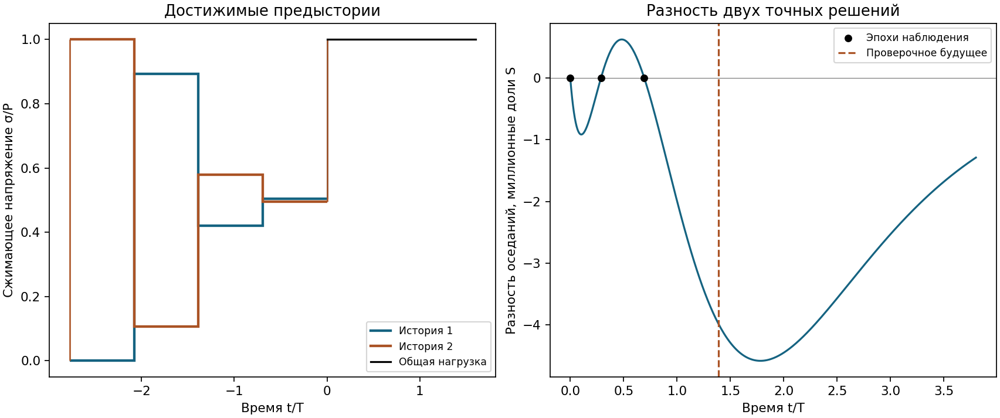
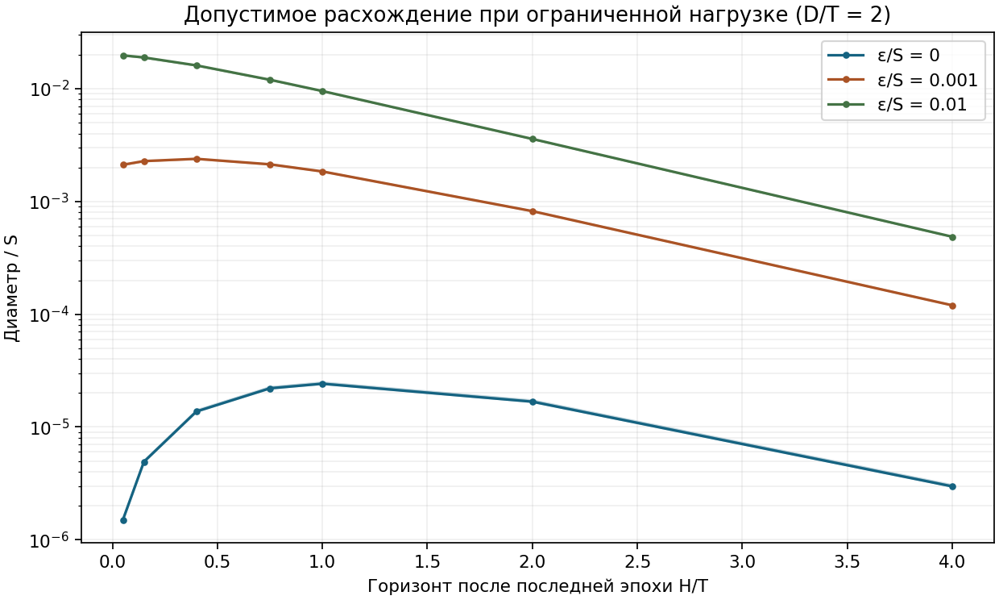

# R2. Одинаковые наблюдения при разных достижимых предысториях

**Результат.** В пассивной линейной системе с фиксированными материальными параметрами и геометрией можно получить в точности одинаковые оседания в трёх исторических эпохах и различные будущие оседания при одной и той же нагрузке. Различие создают предшествующие ограниченные сжимающие нагрузки. Никакие коэффициенты материала между траекториями не меняются. В одном конструктивном примере расхождение достигает 1,8146 % объявленного масштаба оседания даже без шума. В другом — лишь около четырёх миллионных долей масштаба. Эти значения объясняют, почему одного доказательства существования для инженерного вывода недостаточно.

## 1. Система, геометрия, наблюдение

Берём квазистатический одноосный столб высотой $L$ с закреплённым основанием и однородным осевым напряжением $\sigma\ge0$. Измеряется вертикальное укорочение верха $s=L\epsilon$. В обеих копиях одинаковы $L$, сечение, опоры, исходное ненагруженное состояние и все коэффициенты. В принятой модели $\epsilon=J_0\sigma+\sum_{j=1}^n q_j$, $\dot q_j=\lambda_j(J_j\sigma-q_j)$, $J_j,\lambda_j>0$. По окончании подготовительной предыстории, начиная с $t=0$, нагрузки тождественны, включая входы во все наблюдаемые эпохи. Поэтому
$$
 d(t)=s_+(t)-s_-(t)=\sum_{j=1}^n c_j e^{-\lambda_jt},\qquad c_j=L(q_{j,+}(0)-q_{j,-}(0)). \tag{N1}
$$
У $d,c_j$ единица м. Положительность $J_j$ не требует одинакового знака у $c_j$: последние являются разностями **состояний** двух положительных систем. Упругая часть при одинаковом напряжении сокращается. Постоянная необратимая компонента в эту конструкцию не включена. При добавлении свободной вязкой ветви разность приобретает постоянный член, либо предыстории придётся уравнять ещё по интегралу напряжения.

## 2. Доказательство для конечного числа эпох

Пусть $t_1<\ldots<t_m$ — любые различные конечные наблюдаемые времена после начала общего участка, $n=m+1$, $\lambda_j=j/T$, $T>0$. Положим $z=e^{-t/T}$, $z_i=e^{-t_i/T}$,
$$
 d(t)=C z\prod_{i=1}^{m}(z-z_i). \tag{N2}
$$
Коэффициенты степеней $z^j$ определяют вектор $c$, $C$ в м. Для $t=t_i$ получаем точный ноль, для любого другого конечного $t$ разность отлична от нуля при $C\ne0$. Множитель $z$ обеспечивает исчезновение памяти при бесконечном времени. Для заданных коэффициентов и $m\ge n$ различных эпох такая неоднозначность невозможна на $n$ различных модах: ненулевой полином с нулём в 0 имел бы более $n$ корней. Для неравноотстоящих положительных скоростей аналогичное ограничение числа нулей следует из теоремы Ролля после умножения суммы на самую медленную обратную экспоненту и дифференцирования, уменьшающего число слагаемых на одно. Повторные скорости нужно предварительно сгруппировать. Весь вывод относится к точному одноканальному наблюдению ненулевого вклада каждой моды.

**Достижимость.** Зададим до $t=0$ период подготовки $D=nh$, разбитый на равные интервалы, нумерация $l=0,\ldots,n-1$ от самой свежей к старой. Пусть $\Delta\sigma_l=P u_l$. Из (M2) без численного интегрирования следует
$$
 c/S=M u,\quad S=L P J_\Sigma,\quad J_\Sigma=\sum_j J_j,\quad
 M_{jl}=\frac{J_j}{J_\Sigma}(1-r_j)r_j^l,\quad r_j=e^{-\lambda_jh}. \tag{N3}
$$
$S$ — м, $M,u$ безразмерны. При различных скоростях $M$ обратима. Если $p$ — вектор коэффициентов $z\prod(z-z_i)$, то $\vert C\vert/S\le1/\|M^{-1}p\|_\infty$ достаточно и необходимо в этом классе кусочно-постоянных интервалов при $|u_l|\le1$. Выбираем $\sigma_{\pm,l}=P(1\pm u_l)/2$. Каждый элемент получает напряжение в $[0,P]$. После $t=0$ можно держать $\sigma=P$. Тогда $q_j(0)\le J_jP$, и обе траектории в общем будущем монотонно оседают. До подготовки обе копии можно считать ненагруженными. Скачки внешней тяги являются входами квазистатической модели, состояния Кельвина непрерывны. При $J_0>0$ скачок упругой энергии учитывается отдельно.

При требовании гладкой нагрузки заменим прямоугольные импульсы гладкими функциями с компактным носителем внутри тех же интервалов. Невырожденность матрицы их моментов сохраняется при достаточном сближении в $L^1$. Решаем новую конечную систему и уменьшаем $C$ при необходимости. Для ограничения скорости $|\dot\sigma|\le V$, $V>0$, масштабируем амплитуды; для неубывающих предысторий накладываем пару противоположных малых возмущений на общий гладкий возрастающий фон, производная которого строго положительна на их носителях. Общие значения и производные у границ можно согласовать гладкими участками. Тогда и уровень, и скорость каждой траектории укладываются в заданные интервалы при наличии запаса. При жёстко заданной программе нагрузки, нулевом запасе энергии или единственном допустимом прошлом доказательство перестаёт действовать. Приведённые ниже амплитуды относятся к указанным ступенчатым входам; существование гладкой пары не переносит на неё тот же численный результат.

## 3. Три точных нуля и энергетическая проверка

Воспроизводимый опыт K01–K08 использует $J_j/J_\Sigma=1/4$, $j=1,\ldots,4$, $h=T\log2$. Исторические $z_i=1,3/4,1/2$, будущий $z_f=1/4$. Полином имеет коэффициенты по возрастанию степени $(-3/8,13/8,-9/4,1)$. В (N3) получены **точные рациональные** числа
$$
 \frac{C}{S}=\frac{35}{206336},\quad
 u=\left(\frac{157}{19968},-\frac{24667}{154752},\frac{15191}{19344},-1\right),\quad
 \frac{d(t_f)}{S}=-\frac{105}{26411008}. \tag{N4}
$$
Последняя эпоха $t_m=T\log2$, горизонт $H=T\log2$. Для $J_0=0$ в единицах плотности энергии $J_\Sigma P^2$ независимое интегрирование по интервалам от исходного нуля до $t_f$ даёт

| Предыстория | Внешняя работа | Конечная запасённая энергия | Накопленная диссипация |
|---|---:|---:|---:|
| $+$ | 0,997222 | 0,458847 | 0,538375 |
| $-$ | 1,324298 | 0,458849 | 0,865449 |

Каждая строка удовлетворяет собственному балансу. Материал не извлекает энергию из подписанных разностей. Ограничение бюджета внешней работы до $t_f$ для этой пары достаточно взять не ниже $1.32430 J_\Sigma P^2$ на единицу объёма; отдельно ограничиваемая общая положительная подведённая работа может быть больше подписанной. Диссипация ограничена соответствующим третьим энергетическим слагаемым. При однородном уменьшении всей нагрузки в $b$ раз оседания масштабируются в $b$, энергия и работа — в $b^2$. Это даёт ненулевые достижимые пары и при произвольно малом положительном бюджете без фиксированного минимального уровня сигнала. [Вывод интервального энергетического баланса](R2_THERMODYNAMIC_ADMISSIBILITY_RU.md).

## 4. Насколько существенна разность при точных эпохах

Второй опыт S01 меняет спектр и размещение эпох **между опытами**, сохраняя их одинаковыми внутри каждой пары. $z$-границы четырёх возрастных интервалов нагрузки равны $(1,0.98,0.88,0.5,0.01)$, поэтому $D=T\log100$. Матрица $M_{jl}=(J_j/J_\Sigma)(z_l^{\lambda_j T}-z_{l+1}^{\lambda_j T})$ точно учитывает неравные интервалы. Для каждого пакета выбрано допустимое $u$ в одномерном ядре трёх строк наблюдения с $\max|u_l|=1$. Все матрицы и условия равенства вычислены в рациональной арифметике; целевой $z_f=0.4$.

| Скорости $\lambda_j T$ | Исторические $z_i$ | Достижимая $\vert d(t_f)\vert/S$ |
|---|---|---:|
| 1, 2, 3, 4 | 1, 0.75, 0.5 | 0,000000264 |
| 1, 2, 3, 4 | 1, 0.98, 0.96 | 0,000001700 |
| 1, 4, 16, 64 | 1, 0.75, 0.5 | 0,00008335 |
| 1, 4, 16, 64 | 1, 0.98, 0.96 | **0,01814559** |

Последняя строка даёт компактную историю наблюдений длительностью $0.040822T$ и прогноз на $0.875469T$ после последнего измерения. Нормированные разности нагрузок от самой молодой к самой старой равны приблизительно $(-0.173275,\ 0.422283,\ -0.866756,\ 1)$. Три точных уравнения предъявляют одинаковые данные; малость самой деформации поддерживается выбором $P J_\Sigma\ll1$. Чтобы попарное расхождение превысило для иллюстрации **10 мм**, достаточно $L P J_\Sigma>0.55110$ м. При $L=100$ м, $P=10$ МПа, $J_\Sigma=6\cdot10^{-10}$ Па⁻¹ это 10,89 мм и худшая ошибка любой точечной оценки на этой паре не меньше 5,44 мм. Здесь $P J_\Sigma=0.006$. Числа, разделение скоростей, идеальная передача столба и порог заданы для проверки условия. Ни один из них не приписан СКРУ‑1. Для другого $L$, уровня нагрузки, переноса от внутренней деформации к реперу или спектра масштаб следует вычислять заново. В таблице приведены достигаемые **нижние оценки** диаметра, без претензии на универсальный верхний предел.

В опытах S02–S03 полный путь каждой копии независимо интегрирован от нулевого состояния через подготовку и общую нагрузку до будущей эпохи. В единицах $J_\Sigma P^2$ получены работа, запасённая энергия и диссипация соответственно $(1.617508,0.458692,1.158816)$ и $(1.102741,0.444551,0.658190)$. При выбранных выше условных $P,J_\Sigma$ единица плотности энергии равна $60$ кДж/м³. Две независимые конечные деформации вновь дают разность $0.01814559\,P J_\Sigma$. Эти числа задают потребную суммарную подписанную работу в предъявленном примере. Ограничение на всю положительную подведённую работу рассматривается отдельно в (T2)–(T3).

## 5. Количественная неоднозначность с ошибкой измерения

Для фиксированного времени $\theta$ введём функцию возраста нагрузки
$$
 k_\theta(a)=\sum_j (J_j/J_\Sigma)\lambda_j e^{-\lambda_j(\theta+a)},\qquad
 d(\theta)/S=\int_0^D k_\theta(a)u(a)\,da,\quad |u|\le1. \tag{N5}
$$
Здесь $\theta,a,D$ в одних единицах времени, $k$ в обратном времени. Погрешность каждого наблюдения каждой истории ограничена $\varepsilon$ в м по модулю. При сравнении двух историй допустимо $\vert\int k_{t_i}u\vert\le2e$, $e=\varepsilon/S$. Для любого вектора $v$ получаем **верхнюю оценку для всех ограниченных предысторий**
$$
 \frac{\Delta_H}{S}\le 2e\|v\|_1+
 \int_0^D\left| k_{t_m+H}(a)-\sum_i v_i k_{t_i}(a)\right|\,da . \tag{N6}
$$
Доказательство — вычесть и прибавить историческую комбинацию и оценить оба слагаемых. $\Delta_H$ здесь — худший попарный диаметр среди совместимых с некоторым общим измерением, не условный диаметр по конкретному вектору реперов. Входной класс сохраняет физическую достижимость согласно (M2). Для сферически или коррелированно ограниченного шума $2e\|v\|_1$ заменяется опорной функцией соответствующего множества ошибок разности. Например, для $\|R^{-1/2}e_i^{\rm vector}\|_2\le1$ в размерных координатах это $2\|R^{1/2}v\|_2$.

Есть отдельная точная оценка при ограничении среднеквадратической нагрузки. В координатах состояния пусть допустимые разности удовлетворяют $d_q^T W^{-1}d_q\le U^2$ из (M3), исторические строки равны $A$, будущая строка оседания равна $B_H$. При точном совпадении данных положим $d_q=W^{1/2}z$. Максимум $|B_Hd_q|$ по этому эллипсоиду и $Ad_q=0$ в точности равен $U\|B_HW^{1/2}P_{\ker(AW^{1/2})}\|_2$ по неравенству Коши и выбору направления проекции. При одновременном ограничении пиковой нагрузки это верхняя оценка. При отдельном ограничении **механической** запасённой энергии каждой копии величиной $w_*$ (Дж/м³) из (T2) следует $\|\operatorname{diag}(J_j^{-1/2})d_q\|_2\le2\sqrt{2w_*}$. Следовательно, для скалярного будущего уровня верхний предел только по запасённой памяти равен не более $2L\sqrt{2w_*\sum_jJ_j e^{-2\lambda_j(t_m+H)}}$. Он может быть грубым из-за истории и общей нагрузки. Внешняя работа и диссипация требуют самостоятельных ограничений по пути.

**Нижняя граница** строится на 24 постоянных интервалах нагрузки решением линейной задачи с ограничением $|u_l|\le1$. На этих интервалах интегралы экспонент взяты точно. Допустимость численного вектора контролируется проекцией на ядро при $e=0$ или уменьшением амплитуды при $e>0$. Из двойственных множителей этой малой задачи получен $v$ для (N6). Интеграл для непрерывного класса подсчитан по корням экспоненциального полинома и независимо проверен квадратурой. Получены нижняя и верхняя оценки для одного и того же класса предысторий, между которыми может оставаться зазор. Числа округлены; плавающая арифметика не даёт формальной интервальной сертификации последних знаков. Для математически точного свидетельства существуют (N4) и S01.

Исторические эпохи в следующей таблице как в (N4), $\lambda_j T=j$, доли податливости равны. Горизонт $H=0.75T$ отсчитан от последней эпохи.

| $D/T$ | $\varepsilon/S$ | Нижняя оценка $\Delta_H/S$ | Верхняя оценка $\Delta_H/S$ |
|---:|---:|---:|---:|
| 0,25 | 0 | $5.1321\cdot10^{-8}$ | $5.2141\cdot10^{-8}$ |
| 2 | 0 | $2.2013\cdot10^{-5}$ | $2.2860\cdot10^{-5}$ |
| 8 | 0 | $3.2179\cdot10^{-5}$ | $5.3088\cdot10^{-5}$ |
| 0,25 | 0,001 | 0,00102465 | 0,00102477 |
| 2 | 0,001 | 0,00213327 | 0,00215315 |
| 8 | 0,001 | 0,00242738 | 0,00279820 |
| 2 | 0,01 | 0,01199505 | 0,01200945 |

При $S=1$ м, $D=2T$, $H=0.75T$ и ошибке каждой эпохи 1 мм диаметр составляет примерно 2,13–2,16 мм; при 10 мм — 11,99–12,02 мм. Критерий «попарный размах более 10 мм» и критерий «минимаксная ошибка более 10 мм» различаются множителем два для скалярной цели. Реальный порог зависит от объекта, горизонта и решения, для которого используется прогноз. При $H\to\infty$ разность обратимых мод затухает. При $H=0$ и точном последнем уровне она равна нулю. Поэтому точечная неоднозначность может сначала расти, а потом спадать. Диаметр траекторий в супремум-норме на всём $[0,H]$ при неизменных классах монотонен по включению интервалов. Устойчивое приближение одной траектории не разрешает различие между траекториями.

## 6. Проверка на ядре с параметрами соли ВКМ

Барях, Константинова, Асанов, 1996, §4.3, табл.11 и формулы (4.1)–(4.2) (SRC-044). Для **одной** кривой подстилающей каменной соли при относительной одноосной нагрузке 0,2 напечатаны $\alpha=0.69$, $\delta=0.047\ {\rm с}^{\alpha-1}$. Размеры цилиндров 36×72 мм, кратковременная прочность серии $22.0\pm1.20$ МПа. Указанная авторами ориентировочная верхняя граница линейной области — около $0.4\sigma_{\rm сж}$. Коэффициенты для фиксированного $\alpha=0.7$ в соседнем столбце относятся к другой обработке. Из этого опыта не выводятся четыре дискретных скорости из (N4). Проверим **другую конструкцию прямо для опубликованного непрерывного ядра**.

Два опыта имеют одинаковый $E$, одно ядро и одинаковую будущую нагрузку. В окрестности уровня $0.2\sigma_{\rm сж}$ примем локально-линейную гипотезу для малых программ нагружения; испытания первоисточника выполнялись на постоянных уровнях. Пусть при подготовке разность нагрузок $P u_l$ на четырёх интервалах возраста $lh\le a<(l+1)h$. Тогда для безразмерного $t$ в единицах $h$ и $h_s$ в секундах
$$
 \frac{d(th)}{L P/E}=\frac{\delta h_s^\nu}{\nu}\sum_{l=0}^3 u_l
 \big[(t+l+1)^\nu-(t+l)^\nu\big],\quad \nu=0.31. \tag{N7}
$$
Получено прямым интегрированием $K$; общий мгновенный упругий отклик сокращается. Ставим три нуля при $t=0,1,2$, проверяем $t=6$, то есть $H=4h$ после последней эпохи. При $\max |u_l|=1$ пригоден вектор приблизительно $(-0.004744,\ 0.315564,\ -1,\ 0.725567)$. Сумма в (N7) при $t=6$ по модулю $0.0007268824$. Приведённые округлённые нагрузки нужны для чтения; в проверке используется полная точность.

**Почему нули не артефакт округления.** Рассмотрим матрицу моментов функции $(t+a)^{-\alpha}$ на последовательных непересекающихся интервалах $a$. При возрастающих $t_i$ и возрастающих $a_l$ детерминант точечного ядра положителен: подставим (6), раскроем определитель и симметризуем интеграл по $\lambda_1,\ldots,\lambda_n$. На упорядоченной части области под интегралом стоит произведение $\det[e^{-\lambda_j t_i}]\det[e^{-\lambda_j a_l}]$ с положительной мерой. Оба определителя имеют один строгий знак по свойству системы различных экспонент (доказательство Ролля в §2 и непрерывность при упорядоченных узлах). Интегрирование точечного определителя по отдельным возрастным интервалам сохраняет строгую положительность. Если первая эпоха и левая граница равны нулю, единичный угловой сингулярный предел интегрируем при $\alpha<1$; тот же вывод получается исключением нулевой границы и монотонным предельным переходом для положительного определителя. Поэтому три строки имеют ранг 3, добавление четвёртой более поздней эпохи даёт ранг 4. Вектор алгебраических дополнений трёх строк даёт **точный** ненулевой вход, невидимый в трёх прошлых эпохах и видимый в четвёртой. Энергия и диссипация для конечных ступеней конечны по положительному спектральному представлению в [термодинамическом исследовании](R2_THERMODYNAMIC_ADMISSIBILITY_RU.md).

| Ширина $h$, ч | Длина подготовки $4h$, ч | Горизонт после последней эпохи $4h$, ч | Достижимое $\vert d(6h)\vert/(LP/E)$ |
|---:|---:|---:|---:|
| 6 | 24 | 24 | 0,002432 |
| 24 | 96 | 96 | 0,003737 |
| 96 | 384 | 384 | 0,005743 |

При трактовке заголовка табл.11 секунды переведены до возведения в степень. Подстановка числа часов напрямую занизила бы результат в $3600^{0.31}\approx12.66$ раза. Для $P=0.02\sigma_{\rm сж}\approx0.44$ МПа пара локальных историй $\sigma_\pm=(0.2\sigma_{\rm сж})\pm P u_l/2$ лежит между $0.19$ и $0.21$ кратковременной прочности. Начальная общая часть и последующее общее напряжение задаются одинаково. При $h=24$ ч и длине образца 72 мм эффект достигает одного деления 0,001 мм индикатора из описания установки только при $E\lesssim0.1184$ ГПа для данной конструкции. Это решение неравенства для модуля. Значение $E$ этого же опыта не подставлялось из другой породы или серии, а цена деления не является доверительной границей измерения.

С самим лабораторным опытом возможна и безмодульная количественная сверка. При базовой ступени $\sigma_b=0.2\sigma_{\rm сж}$ за $h$ модельная накопленная часть укорочения равна $L(\sigma_b/E)\delta h_s^\nu/\nu$. Отношение найденного расхождения к этой части равно $(P/\sigma_b)\,0.0007268824=0.00007268824$, то есть около **0,00727 %** при указанной амплитуде разности нагрузок. Сократились $E,L,\delta$ и единица времени. Число характеризует предъявленную пару для источниковой формы закона; более крупные различия других допустимых пар этим не исключаются.

Для условного столба и критерия 10 мм при том же $h$ требуется $LP/E\gtrsim2.676$ м. На руднике $L$ заменяется действием пространственного оператора и поддержкой нагрузки. Параметры относятся к образцам, а не к выработанному массиву. Даже отрицательный вывод о величине неоднозначности всего СКРУ‑1 из малого лабораторного числа не следует. Отличие практической величины от математической возможности установлено двумя независимыми способами — точным дискретным спектром и исходным непрерывным ядром.

## 7. Итог для гипотезы G1

Существование двух физических предысторий внутри явно описанного класса установлено, в том числе при одном фиксированном законе и трёх точных наблюдениях. Достаточные условия обратного вывода также известны: одинаковый полный начальный вектор и детерминированное корректно поставленное продолжение дают одинаковое будущее; достаточно много разных точных эпох может разделить все моды известной конечной цепи. Центральное ограничение для СКРУ‑1 — неизвестное сочетание достижимого диапазона нагружения, спектра эффективной памяти, передаточной способности сети и ошибок. Поэтому G1 доказана как возможность в механической модели. Фактическая инженерная величина для рудника сохраняет статус **TEST_REQUIRED**. Код, входы и все 63 комбинации $D,H,\varepsilon$ доступны в [протоколе проверок](R2_CHECKS/README_RU.md).
